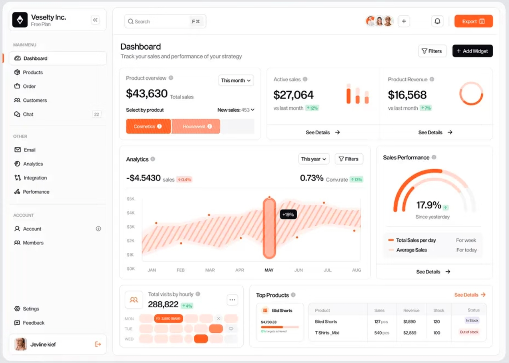
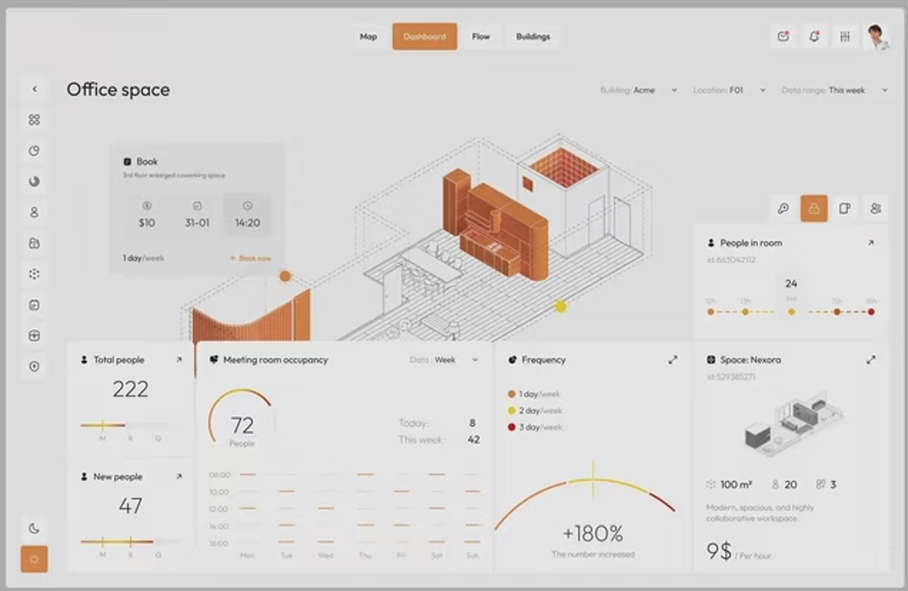

# PetHaven dashboard: specification

Version 3.0 · 15 October 2026
Status: brief for the change agreed on 15 October. The data use cases were reorganised so that each role sees only the information it acts on (section 1). Sections 1 and 4 to 8 describe the target; until the change is built, the running dashboard still follows version 2.0 (in the Git history). How to start and check it is in [dashboard_runbook.md](dashboard_runbook.md).

Version 1.0 (6 October) was the brief for building the dashboard. It also asked for an Integration & Quality page and a business demo panel that wrote to the database. Both were removed on 13 October: the dashboard became read-only, and the end-to-end demonstration moved to the recorded video ([demo/video_demo_script.sql](../demo/video_demo_script.sql)), as the tutor asked. The version 1.0 text is in the Git history.

## 1. Purpose and scope

The dashboard is the business-facing output of the prototype. It answers the four data use cases in the [Spec, section 9](../00_req_feedback/Assignment2_Spec_update.md), ordered by impact:

| Use case | User | Impact | Question | Page |
| --- | --- | --- | --- | --- |
| UC1 See the business impact | Owner (final decision-maker) | High | In the last 7 days, how much did we sell in store and online, which products sell best and how fast, and how many sales did we lose at checkout, and why? | Overview, with Potential lost sales as its detail |
| UC2 Check the website stock | Owner | High | Does the website show what the stores really have, and is the automatic refresh running? | Website stock |
| UC3 Spot low stock | Store managers | Medium | Which products is my store running low on? | Store stock |
| UC4 Prepare click & collect orders | Store staff | Low | Which orders must I send, receive or hand over, and which are overdue? | Click & collect orders |

Each role sees only what it acts on. The owner's pages (Overview, Potential lost sales, Website stock) show the whole business and no shelf alerts; out-of-stock and low-stock alerts belong to the store managers' page, and open orders to the store staff's page.

The dashboard only reads. It never records a sale, refreshes the website, or runs the ETL. Business events are made through the source systems' own functions (`demo.py`, or SQL in CloudBeaver).

It is a teaching prototype with synthetic data, not an online shop, payment service or production monitoring tool.

### 1.1 Sources

- [Assignment requirements](../00_req_feedback/Assignment2_Requirements.md), items vi.a to vi.e.
- [Spec](../00_req_feedback/Assignment2_Spec_update.md): business rules, stock definitions, data use cases.
- [Architecture and data model](Architecture_and_Data_Model.md).
- [Report view definitions](../workspace/db/08_reports.sql). The SQL is the authority for fields and calculations.
- Tutor feedback: [29 Sep](../00_req_feedback/29_Sep_tutor_workshop_feedback.md), [6 Oct](../00_req_feedback/06_Oct_tutor_workshop_feedback.md), [13 Oct](../00_req_feedback/13_Oct_tutor_workshop_feedback.md).

### 1.2 How it meets the brief

| Brief evidence | Where on the dashboard | Subject knowledge |
| --- | --- | --- |
| Reports per data use case (at least 3) | Overview and Potential lost sales (Report 4, Report 3), Website stock (Report 2), Store stock (Report 1, Report 4), Click & collect orders (Report 5) | Fact and dimension joins; cross-system comparison |
| Integrated warehouse in use | Every page reads `dw` report views; event history reads `dw.fact_stock_event` | Star schema; lineage through `source_ref` |
| Data quality | Shared banner when the ETL rejected records or the warehouse disagrees with the store system | Validation and reconciliation |
| End-to-end test | Shown in the recorded video, section 5 and 7 | Operational events followed by analysis |

## 2. Business meaning that must stay correct

| Term | Meaning on screen |
| --- | --- |
| Available | `in_store_quantity`: shelf stock free to sell. Reserved units have already left the shelf, so never subtract them again. |
| Reserved | Units held at a store for a click & collect order. Units in transit between stores are in no store. |
| On hand | Available + reserved at one store. |
| Website shows | `online.online_stock.available_quantity`: one combined number per product for all five stores. |
| Stores have | Available stock rebuilt from warehouse events, summed over the five stores. |
| Difference | Website shows − stores have. Shown as "Website too high" (positive) or "Website too low" (negative). |
| Low stock | 2 or fewer units on one store's shelf. A fixed prototype rule, not a reorder point. |
| Blocked item | One item in one checkout attempt that no single store could supply. Found before payment, so nothing was charged. It is a potential lost sale, not a confirmed one. |
| Paid | A successful checkout. No card payment is modelled. |
| Overdue | A click & collect order not collected within 3 days of being held. |

Further rules:

1. Adding to the bag uses the website number and holds nothing.
2. Each order item must come from one store; different items can come from different stores.
3. There are two reasons for a blocked item: the website number was out of date, or there was enough stock in total but no single store had the whole quantity. Do not describe every block as caused by an out-of-date number.
4. The website refresh takes the store system's shelf totals. The warehouse records each refresh; it does not set the website number.
5. `rpt_last_sync_changes` holds both website corrections and store balance changes. Only `measure = 'online_available'` is a website correction.
6. `dw.sync_run.numbers_changed` counts changed rows, not corrected products. Count corrected products from the filtered rows.
7. Current stock has no date filter. Date filters apply only to history: events, checkout attempts, sales.
8. Show Sydney time (`Australia/Sydney`, with daylight saving).

## 3. Visual direction

The two reference images set the style and colours, not the content.

- [Reference 01: layout](dashboard-reference/reference-01-layout.png): sidebar, white cards, thin borders, clear tables, generous spacing.
- [Reference 02: palette](dashboard-reference/reference-02-palette.png): warm grey surfaces, muted terracotta, calm type.





### 3.1 Colour tokens

```css
:root {
  --page-bg: #F3F2EF;
  --sidebar-bg: #FAF9F7;
  --surface: #FFFFFF;
  --surface-subtle: #F7F5F2;
  --border: #E4E0DA;
  --text: #242320;
  --text-secondary: #66615A;
  --text-muted: #6F695F;
  --accent: #C7773E;
  --accent-hover: #AD6030;
  --accent-soft: #F7E8DA;
  --accent-text: #84441F;
  --primary-action: #282622;
  --primary-action-text: #FFFFFF;
  --success: #35634C;
  --success-bg: #EAF2EC;
  --warning: #805817;
  --warning-bg: #FAF0D9;
  --danger: #A13E36;
  --danger-bg: #F8EAE7;
  --focus: #84441F;
}
```

`--text-muted` was darkened from the original #777168 to #6F695F to reach 4.9:1 contrast on the page background.

- Terracotta marks the active page and selected data. Not every number is orange.
- Error, warning and success use text as well as colour. "Website too low" is information, not a success state.
- No gradients, glass effects, neon colours or heavy shadows.

### 3.2 Type, spacing and screen sizes

- Font `Inter, "Segoe UI", system-ui, sans-serif`, with no external font request.
- Page title 28 to 30 px; section title 16 to 18 px; body and tables 14 px. Tabular numbers, right-aligned in tables.
- Sidebar 224 to 240 px; card radius 14 px; inputs and buttons 8 px.
- At 768 px and below the sidebar becomes a drawer and content is one column. At 375 px nothing is wider than the screen except wide tables, which scroll inside their own box.

## 4. Layout and shared behaviour

Navigation, in this order: **Overview**, **Potential lost sales**, **Website stock**, **Store stock**, **Click & collect orders**. The sidebar groups them by role: Owner (the first three), Store managers, Store staff. Sidebar brand **PetHaven**, subtitle **Inventory data solution**.

Top bar: page name, a "Synthetic data · Lab prototype" label, the time the reports were read, and a **Reload** button. Reload only reads the reports again; it never refreshes the website or runs the ETL.

When the ETL has rejected records or the warehouse disagrees with the store system, a yellow banner appears on every page: "Some records are missing from the reports", with the counts. It clears once the records load.

Filters and selections are kept in the URL, so a reload or a shared link shows the same view. Filters belong to the section they affect; there is no global date or store picker.

When a scheduled website refresh is due, the Website stock page reads its reports again a moment later, so the new numbers appear without a click.

## 5. Overview (UC1, owner)

Data: `dw.rpt_daily_sales` per product and channel (Report 4 is grouped by category today, so the per-product rows need a query over the same sales events), `dw.rpt_checkout_blocked` with each item's value at `dim_product.unit_price`, and the refresh and data quality status.

- Headline tiles for the last 7 days, each linking to its detail: **Sales** (units and value, in-store and online), **Potential lost sales** (units, value, and share of online demand lost = units blocked ÷ (units sold online + units blocked)), **Website stock** (matches the stores or not, refresh running or not).
- **Best sellers**: a bar chart of units sold per product, in-store and online shown side by side, ranked, with units per day. Values are labelled "at current price", as on the Sales tab.
- **Needs attention**, owner-level only: the automatic refresh is not running, checkouts were blocked, records are missing from the reports. When nothing needs attention it says so.
- **Latest potential lost sales**, linking to the Potential lost sales page.

The Overview shows no out-of-stock or low-stock lists and no open order counts; those are on Store stock (UC3) and Click & collect orders (UC4). There is no profit figure (no cost prices) and no returns figure (returns are not recorded).

## 6. Website stock (UC2, owner)

Data: `dw.rpt_online_vs_actual`, `dw.rpt_online_staleness`, `dw.rpt_last_sync_changes`, `dw.sync_run`.

- Status line: whether the automatic refresh is running, its interval, the countdown to the next refresh, and when the last refresh ran and whether it was automatic or manual.
- Banner: "The website matches the stores for all 18 products", or "N of 18 products show the wrong stock on the website", split into too high and too low.
- **Products with the wrong number on the website**: Product, Website shows, Stores have, Difference. Selecting a product opens its stock by store.
- **What the last refresh corrected**: when it ran (automatic or manual), how many website numbers it corrected, and a table of Product, Website before, Website after, Change, from `measure = 'online_available'` only.

The website number is a five-store total, so this page has no store filter.

## 7. Store stock (UC3, store managers)

Data: `dw.rpt_current_stock_by_store`, `dw.fact_stock_event`, `dw.rpt_daily_sales`.

Tabs: **Current stock** and **Sales**. A manager looks at one store, so the store filter comes first; all stores stay available for comparison.

Current stock:

- Views: by store, or a list. Filters: store, product, category, **Low stock only**.
- Columns: Store, Product, Category, Available, Reserved, On hand, Stock status. Status labels: Out of stock (0), Low stock (1 to 2), Available.
- Selecting a store and product opens its **event history**: every sale, delivery and order that changed that number, newest first, with event type, available change, reserved change, order or basket reference and source reference. A blocked checkout appears with zero change; it is a recorded outcome, not stock used.

Sales: units sold per day by store, channel (in-store or online) and category, so a manager can see how fast a low product sells before reordering. Online sales count at the pickup store. "Sales value at current price" is labelled as such, because prices are not kept historically.

## 8. Potential lost sales (UC1 detail, owner) and Click & collect orders (UC4, store staff)

These were two tabs of one page in version 2.0. They serve different roles, so they become two pages.

### 8.1 Potential lost sales (`dw.rpt_checkout_blocked`)

The detail behind the Overview's lost-sales tile.

- Columns: When, Product, Wanted, Value, Website showed, Stores had, Pickup store, Why.
- Reason labels: "Website number was out of date" and "No single store had enough".
- Filters: date range, product, pickup store, reason. The default shows all history, so the blocked checkout in the sample data is visible.
- Selecting a row opens the **Source checkout record** from the online store: outcome, bag, pickup store, and for each item the website number captured at checkout ("Website snapshot (source)") next to the warehouse's reconstruction ("Report reconstruction"). If the two differ, the page shows both.

### 8.2 Click & collect orders (`dw.rpt_open_reservations`)

For the staff at one store's click & collect counter.

- **My store** filter: lines this store must send (it is the source store) and orders collected here (it is the pickup store).
- Count tiles in working order: Overdue (not collected within 3 days), To send, In transit, Ready to collect.
- Order list sorted by urgency, overdue first: order, product, units, source store, pickup store, status (Waiting to be sent, In transit, Ready for collection), whether the whole order is ready, waiting time, overdue. "Order ready" comes from the report and is not recalculated from the visible rows.
- Orders are identified by order number; no customer names are stored.

## 9. API

All endpoints are `GET` and return JSON. Any other method returns 405 ("The dashboard is read-only").

| Endpoint | Returns |
| --- | --- |
| `/api/health` | Database available, database name, server time |
| `/api/status` | Refresh scheduler state and the data quality summary for the banner |
| `/api/overview` | Overview tiles and lists |
| `/api/website-stock` | Website vs stores per product, refresh status |
| `/api/sync/latest` | The latest website refresh and the website numbers it corrected |
| `/api/stock` | Current stock per store and product, with filters |
| `/api/stock/events` | Event history for one product at one store, paged |
| `/api/sales` | Daily sales with filters |
| `/api/checkout/blocked` | Blocked items with stable event and attempt identifiers |
| `/api/checkout/attempts/{id}` | One source checkout attempt and its items |
| `/api/reservations` | Open click & collect order lines |

Responses use one envelope: `data`, plus `meta` with the read time, time zone, database, scope, the views read, and warnings. Big integer IDs are sent as strings. Bad parameters return 400, missing records 404, and an unreachable database 503 with a readable message and no stack trace.

## 10. Data rules for the code

- One database connection per request, closed after it. Read-only transactions.
- Two reports deliberately mix sources: `rpt_online_vs_actual` compares the live website number with warehouse stock, and `rpt_reconciliation` compares the live store system with the warehouse. The source checkout record reads the online store directly. Label these honestly.
- Items not on the warehouse product list are not in the website comparison.
- Only whitelisted sort columns and filters reach SQL; parameters are always bound.

## 11. Files and lab setup

```text
workspace/dashboard/
  server.py              local HTTP server, routing, error handling
  queries.py             read-only queries over the report views
  serialization.py       timestamps, IDs, intervals, JSON
  static/                index.html, styles.css, app.js, api.js, components/ui.js, pages/*.js
  compose.dashboard.yml  optional overlay that runs the dashboard on 127.0.0.1:8080
workspace/tests/check_dashboard.py   API checks on pethaven_check
```

The overlay adds one service, `dashboard`, built from the lab's own `python/Dockerfile`. The supplied `docker-compose.yml`, `python/Dockerfile` and `python/requirements.txt` are unchanged, and the lab's `python` container stays free for `build.py`, `demo.py` and the checks. The server never builds or rebuilds a database.

Static files are served only from `static/`; there are no directory listings and no credentials in the browser code.

## 12. Empty and error states

| Situation | What the page shows |
| --- | --- |
| No website refresh yet | "No refresh has run yet" |
| Every product matches | A positive message, with the data still visible |
| Last refresh changed nothing | "Nothing needed correcting: the website was already right." |
| No blocked items for the filters | "No blocked item records match these filters" and Clear filters |
| No open orders | "No open lines match these filters" |
| Database unavailable | An error panel with Retry; no zero-filled tables or mock data |

Tables, headings and form labels are semantic HTML. Everything works by keyboard, nothing depends on hover, and colour is never the only signal.

## 13. Checks

`check_dashboard.py` builds `pethaven_check`, starts the server in-process, makes business events with the source systems' own SQL functions and checks (38 checks, all PASS on 15 October 2026):

- website comparison, stock, blocked items, reservations and overview tiles against their report views;
- that current stock ignores date parameters;
- 400 for bad parameters, 404 for missing records and endpoints, 405 for any write request;
- that a sale changes warehouse stock but not the website number, carries its receipt number, and that cartons become units;
- that a blocked checkout appears with its attempt, and its source record shows no order and an open bag;
- that the latest refresh's website corrections are filtered to `online_available`;
- that the data quality banner appears when P019 is rejected and clears once it is added and loaded;
- Sydney business dates and the history date filter;
- the 503 response when the database cannot be reached.

The business rules underneath are covered by `check_demo.py` (104 checks) and the refresh scheduler by `check_scheduler.py` (17 checks). Browser checks were done at 1440, 1280, 768 and 375 px wide.
